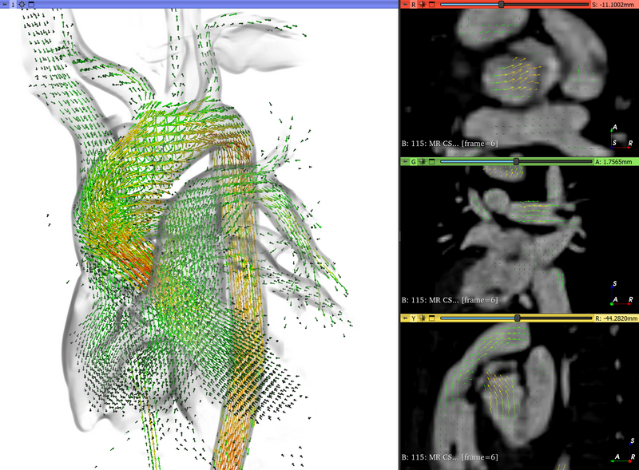

# Import 4D Flow

Converts 4D flow MRI phase-contrast images to a "flow field" and corrects it. The flow field is a vector volume sequence
that stores the velocity vector of each voxel in mm/s (the unit is recorded in the voxel value units of the volumes, and in
the `units` field of NRRD files). The flow field can be analyzed in the [Analyze 4D Flow](Analyze4DFlow.md) module.



Two flow fields are used:

- **Input flow field:** the velocity as acquired (aliased, before any correction), with the velocity encoding. It is
  loaded from DICOM by the 4D flow DICOM plugin of SlicerHeart, or loaded from file (a vector volume sequence).
- **Output flow field:** the result of all corrections (phase unwrapping, noise masking, background correction,
  divergence-free filtering), computed from the input flow field.

Flow fields stored in grid transforms (velocity in m/s), created by earlier versions of the module, can still be read
(visualized, analyzed, exported), but processing results are always written into vector volumes.

## How to use

### Load 4D flow DICOM images

- Import the 4D flow MRI DICOM files (the 3 velocity component series and the magnitude series) into the Slicer DICOM
  database by dragging the containing folder into the application window.
- Load the series into the scene using the DICOM module: select all series of the study, then click `Load`. The 4D flow
  DICOM plugin of SlicerHeart (`Import4DFlowDicomPlugin`) recognizes the magnitude and velocity component series of an
  acquisition from their DICOM headers and loads them directly as the input flow field (velocity as acquired) and the
  magnitude image sequence. Its loadables ("... - 4D flow magnitude", "... - 4D flow velocity ...") are selected by
  default instead of the volume sequence loadables of the same series (`Advanced` shows all loadables). The study must
  contain the 3 velocity components and the magnitude image, for example:
  - Siemens: "112: CS4Dflow_R7.7_retro_post 1.6 x 1.6_P", "113: CS4Dflow_R7.7_retro_post 1.6 x 1.6_P",
    "114: CS4Dflow_R7.7_retro_post 1.6 x 1.6_P", and "115: CS4Dflow_R7.7_retro_post 1.6 x 1.6"
  - GE: 5 series with the same description, for example "70: AX 4D FLOWQ v250" ... "74: AX 4D FLOWQ v250" (magnitude,
    3 velocity components, and a complex difference image, which is loaded as an additional image sequence of the
    acquisition)
  - Philips: "3703: anatomy", "3704: RL", "3705: AP", "3706: FH"
  All series of the acquisition must be selected together: if some are missing, the series can only be loaded as volume
  sequences. The pixel data is read directly from the files (uncompressed files; other files are read with pydicom), which
  is much faster than loading the series as volume sequences.
- Open the Import 4D Flow module: the input flow field and its magnitude image are selected in the `Corrections` section.
- Click `Recompute flow field`. The output flow field (with the selected corrections) is created and selected.

Siemens, GE, and Philips 4D flow DICOM images (one file per slice and cardiac phase) can be imported. The DICOM tags that
identify the images and the velocity scaling and direction conventions of each vendor are described in
[Vendor DICOM conventions](#vendor-dicom-conventions).

### Load a flow field from file

A vector volume sequence (for example a `.seq.nrrd` file) of the velocity as acquired can be used as input flow field:

- Load the velocity file and the magnitude image file.
- Select the velocity as `Input flow field` in the `Corrections` section.
- Select the magnitude images as `Magnitude image`. They are needed for noise masking, background correction, PC-MRA and
  lumen estimation. If their frame times are the same as those of the input flow field, they are moved into the sequence
  browser of the flow field, so that they are browsed together.
- Click `Recompute flow field` to compute the output flow field.

### Corrections

Corrections are set in the `Corrections` section and applied by `Recompute flow field`.

- `Input flow field`: velocity as acquired. `Delete` removes the input flow field (its sequence and proxy node).
- `Magnitude image`: magnitude images of the input flow field.
- `Output flow field`: the corrected flow field. If none is selected (`Create new flow field`), a new one is created.
- `Show`: show the flow vectors, the magnitude image, or one of the velocity components (labeled by their encoding
  direction) in the slice views. The velocity components are shown as acquired, so that phase wraps can be seen and edited.
- `Lumen`: optional segmentation of the blood pool (vessels and heart chambers). It is used by the slicerheart_4dflow
  methods: it is excluded from the background fit, and it is the region of divergence-free filtering, the encoding check and
  the quality report. `Compute` estimates the lumen automatically (see below) and overwrites the selected segment; a new
  segmentation and segment are created if none is selected. The result should be reviewed and edited in Segment Editor. A
  segment on a grid finer than the image is used with partial voxels at its boundary.
- `PC-MRA`: velocity-weighted phase-contrast MR angiogram (Bock 2010). `Compute` overwrites the selected volume, or creates
  a new one.
- `Noise mask`: voxels in the mask are set to zero velocity.
  - `magnitude threshold`: magnitude below `Noise magnitude threshold`.
  - `magnitude and velocity noise (slicerheart_4dflow)`: low time-averaged magnitude (Otsu threshold) or random phase
    (very high temporal velocity variation), see Bock 2007.
- `Background subtraction`: a polynomial is fitted to the velocity in stationary tissue and subtracted. The default is
  `quadratic fit`: without background subtraction the residual offset in static tissue is usually above the acceptable
  0.6 cm/s, which the quality report checks.
  - `linear fit`, `quadratic fit`: fitted to each frame, in voxels where the speed is below `Stationary tissue speed threshold`.
  - `least squares fit`, `robust fit: MSAC`, `robust fit: weighted least squares` and
    `robust fit: wrap-around rejection + MSAC` *(slicerheart_4dflow)*:
    - Static tissue is selected automatically: body mask, low temporal variation, vessels excluded.
    - The fit is robust to outliers, and wrap-around rejection is recommended.
    - `Polynomial order` is 2 by default.
    - With `Fit each frame` unchecked, the fit uses the time-averaged velocity.
- `Velocity anti-aliasing`: computes phase wrap segmentations, which can be edited in the segment editor below the selector.
  - `Laplacian 4D` *(slicerheart_4dflow)*: the default. Spatiotemporal Laplacian phase unwrapping (Loecher 2016). If
    slicerheart_4dflow cannot be installed, temporal unwrapping is used.
  - `Laplacian 3D` *(slicerheart_4dflow)*: spatial Laplacian phase unwrapping of each frame.
  - `Laplacian 3D + temporal` *(slicerheart_4dflow)*: Laplacian 3D phase unwrapping, then temporal correction. The temporal
    correction can add false wraps in voxels with low signal (for example at the vessel wall), which are carried over to
    all later frames: on a clinical case it added ten times more wraps than Laplacian 3D or 4D unwrapping found, at
    velocities near zero, and doubled the divergence in the lumen.
  - `temporal`: wraps are detected by comparing consecutive frames, assuming no wraps in the first frame. A change larger
    than venc between frames is counted as a wrap and is never removed, so random phase noise in voxels with low signal
    accumulates false wraps. On one of 15 clinical test cases, this gave speeds up to 17 m/s with a venc of 2 m/s.
  - Without magnitude images, all voxels are unwrapped.
  - After unwrapping, the result is checked, and a warning is displayed in either of these cases:
    - the 99.9th percentile of the speed in voxels with signal is above 7 m/s
    - more than 1% of the voxels with signal are still wrapped in the last frame, where flow is slow
- `Divergence-free filtering` *(slicerheart_4dflow)*: removes the divergent part of the velocity in the lumen, which reduces
  noise. `finite difference projection` is the most accurate. `divergence-free wavelet denoising` also denoises the
  divergence-free part. It is recommended before computing velocity derivatives (wall shear stress, pressure, vorticity).

Methods marked *(slicerheart_4dflow)* are implemented in the
[slicerheart_4dflow](https://github.com/JolleyLab/slicerheart_4dflow) Python package (version 0.3.0 or later). It is
installed from the Python Package Index automatically the first time such a method is used. To install a development
version from a source tree, set the `SLICERHEART_4DFLOW_SOURCE` environment variable (or the
`SlicerHeart/slicerheart_4dflowSource` application setting) to the source tree folder. This requires Slicer 5.10 or later
(Python 3.12).

#### Lumen estimation

The automatic lumen segmentation (slicerheart_4dflow `estimate_lumen`) thresholds the PC-MRA on a grid twice as fine as
the image. The PC-MRA threshold alone cuts inside the vessel wall (it missed about 10% of the flow on clinical cases),
therefore the result is grown toward the wall into voxels where the speed is above the velocity noise. The velocity noise
is estimated in static tissue selected by the magnitude. If it cannot be estimated (for example, synthetic images without
stationary tissue), the lumen is not grown toward the wall and only the PC-MRA threshold is used; this is displayed after
the computation. The segment keeps the finer grid, so it can be edited at that resolution.

### Quality checks

The `Quality` section uses slicerheart_4dflow:

- `Check encoding directions`: ranks all signed permutations of the velocity components by the divergence of the
  time-averaged velocity in the lumen. A warning is displayed if the component directions or signs detected from the DICOM
  header are not the most consistent with mass conservation.
- `Compute quality report`: checks the following, and stores the results in a table and shows them in the text box:
  - venc adequacy (aliasing)
  - velocity noise and venc-to-noise ratio
  - residual background offset in static tissue (acceptable below 0.6 cm/s)
  - divergence in the lumen

### Export flow field to files

- Select the flow field to export in the `Corrections` section (the output flow field, or the input flow field if there is
  no output flow field).
- Click the three dots next to `Output directory` and select the output folder.
- Select the export format:
  - `Anonymized Slicer scene`: the entire scene is exported into a new `.mrb` file, with all patient information removed
    from the subject hierarchy and node attributes. The `.mrb` file can be loaded into Slicer and visualized or analyzed
    the same way as the original, non-anonymized scene.
  - `Stack of NRRD files`: one NRRD file for each time point. No other data is exported.
  - `5D NRRD file`: all time points in a single NRRD file (velocity components, 3 spatial axes, time), which can be loaded
    back into Slicer as a vector volume sequence.
  - `Test case (slicerheart_4dflow)`: see [Test cases](#test-cases).
- Click `Export`.

Velocity values are in the unit of the flow field (mm/s; m/s for flow fields stored in grid transforms), which is written in
the header of the NRRD files. Slicer versions before 5.13 do not write the unit into 5D NRRD files; flow fields without unit
are read as mm/s. The NRRD files only contain the flow field, they do not contain any protected health information.

If a flow field exported as a stack of NRRD files from a flow field stored in grid transforms is read back into Slicer as
a transform, invert the transform after reading it, to make sure the transform is used as "transform to parent"
(not "transform from parent", as it is assumed when reading a displacement field from file).

### Adjust flow field visualization settings

The flow vectors of a flow field stored as a vector volume are shown as glyphs by a vector field display node, whose
visualization settings are available in the `Volumes` module. The vector field display node is not yet included in 3D
Slicer releases: in Slicer versions without it, the flow field can be processed, analyzed and exported, and its velocity
components and magnitude can be shown in slice views, but the flow vectors are not shown as glyphs. Flow fields stored as
grid transforms (earlier versions of the module) are shown by the transform display node, whose settings are available in
the `Transforms` module's `Display` section.

## Developer information

### 4D flow DICOM plugin

`Import4DFlowDicomPlugin` is a plugin of the DICOM module (hidden scripted module in the `Import4DFlow` folder,
registered in `slicer.modules.dicomPlugins`). It loads a 4D flow acquisition directly as the input flow field and the
magnitude volume sequence, with the same result as loading the series as volume sequences with MultiVolumeImporter and
converting them, but much faster (for example, 14 s instead of 164 s after indexing for a GE study of 5 series x 5400 files).

- Examine: each series is classified from its first file (`FlowDicom.classifyDataset`, with pydicom), so the velocity
  encoding tags do not need to be in the DICOM tag cache. The frames (trigger times) and slices (positions along the slice
  normal) are collected with bulk tag queries of the DICOM database (`DICOMUtils.fileValues`); series with several images
  at the same position and time (for example, all components in one series) or inconsistent geometry are skipped. The
  magnitude series and the 3 velocity component series of an acquisition (same study and `groupKey`, see the grouping in
  the table below; the RAS order and signs of the components from `FlowDicom.componentConfiguration`) give one loadable
  per series, so that no other interpretation of the series is selected by default: the loadables have a confidence of
  1.1 (MultiVolumeImporter: 1.0; loadables of equal confidence are all selected). Loading any of the loadables loads the
  whole acquisition. All series of the acquisition must be examined together (selected in the DICOM browser).
- Load: the pixel data of uncompressed files (implicit or explicit VR little endian) is read directly from the end of
  each file after verifying the Pixel Data element header (the pixel data is normally the last element); other files
  are read with pydicom. RescaleSlope/RescaleIntercept are applied. The magnitude frames are loaded into a volume
  sequence (browsed by trigger time), and the velocity frames are scaled to RAS velocity (mm/s) and written into the
  input flow field (`Import4DFlowLogic.createInputFlowFieldFromArrays`) frame by frame, so the component images are
  never held in memory.

### Vendor DICOM conventions

The 4D flow images are identified by the 4D flow DICOM plugin (`Import4DFlowDicomPlugin.py`) from the DICOM header of
the first file of each series (`Import4DFlowLib/FlowDicom.py`). The plugin stores the identification in attributes of the
magnitude volume sequence (`SlicerHeart.vendor`, `SlicerHeart.heartRateBpm`, `SlicerHeart.magnitudeRange`) and of the
input flow field sequence (`SlicerHeart.vencEncodedMmPerSec`, `SlicerHeart.encodingToWorld`, `SlicerHeart.directionCodes`,
`SlicerHeart.componentMaxValues`, see `FlowLibraryBridge.setRawEncoding`, and the non-identifying acquisition metadata in
`SlicerHeart.acquisitionMetadata`). The velocity (mm/s) along the encoded direction is
`loaded voxel value * venc (mm/s) / maxValue`, where the loaded value is the stored value with the standard
RescaleSlope/RescaleIntercept applied (as the DICOM reader of Slicer does), and `maxValue` is the loaded value that
corresponds to venc.

| | Siemens (CS 4D flow) | GE (mm4dflow, 4DFLOW) | Philips (classic DICOM) |
|---|---|---|---|
| Image identification | velocity: venc and direction code in private tag (0051,1014) (Avanto) or (0021,1129) (Avanto Fit), for example `v150_through`, or at the end of `SequenceName` (`fl3d1_v150in`); magnitude: `SequenceName` contains `fl3d1r2` or `fl3d1r3` | (0043,1030) Vas collapse flag: 2 magnitude, 3/4/5 L/R, A/P, S/I velocity (8-11: the same, "oblique", unverified), 7 complex difference (auxiliary image, loaded into the same sequence browser) | `ImageType` contains `VELOCITY MAP` (or (2005,1011) is `P`): velocity; (2005,1011) is `M` with (2001,1016) Number of PC directions 3: magnitude; (2001,101A) PC Velocity must be present |
| venc | in the direction code (cm/s) | (0019,10CC) Velocity encoding (mm/s) | (2001,101A) PC Velocity (cm/s), the nonzero element |
| Loaded value scaling | phase in [-4096, 4096), `maxValue` 4096 | no rescale tags; (0019,10E2) Velocity Encode Scale = venc/π scales phase (rad) to pixel value, so `maxValue` = (0019,10E2)·π and the pixel values are mm/s | RescaleSlope/RescaleIntercept (RescaleType `cm/s`) give cm/s, `maxValue` = venc (cm/s) |
| Encoding direction | relative to the image: through-plane, in-plane R/L, A/P, F/H; mapped to RAS by the acquisition orientation (`FlowDicom.SIEMENS_AXIS_CONFIGURATIONS`) | patient axes from the flag: `patient_rl`, `patient_ap`, `patient_fh`, independent of the image orientation | (0018,9090) Velocity Encoding Direction in the (2005,140F) sequence (patient coordinate system); fallback: nonzero element of (2001,101A), or the series description `RL`, `AP`, `FH` |
| Sign convention | per direction configuration (`FlowDicom.SIEMENS_AXIS_CONFIGURATIONS`), verified on clinical data | positive stored velocity points to L, P, S (`PATIENT_AXIS_CONFIGURATIONS["ge"]`) | positive stored velocity points to L, P, S (`PATIENT_AXIS_CONFIGURATIONS["philips"]`) |
| Heart rate | `NominalInterval` | `HeartRate` | `HeartRate` |
| Magnitude range | 255 (fixed) | maximum of the loaded magnitude images | maximum of the loaded magnitude images (after rescale) |
| Grouping of the series | study and `AcquisitionNumber` | study and `SeriesTime` | study and `AcquisitionNumber` |

The sign conventions of GE and Philips are not in the DICOM headers. They were verified on one data set per vendor
(GE DISCOVERY MR750, software 27, `mm4dflow` sequence, axial acquisition of a sheep, venc 250 cm/s; Philips Ingenia
Ambition X, software 12.3, sagittal acquisition, venc 200 cm/s) with the encoding direction check (`Check encoding
directions` in the `Quality checks` section: the divergence of the time-averaged velocity in the lumen must be lowest
for the imported mapping, which fixes the directions and relative signs) and the flow direction in the descending aorta
(caudal in systole, which fixes the global sign). If the check reports an inconsistent mapping for data of another
scanner or software version, the conventions in `FlowDicom.PATIENT_AXIS_CONFIGURATIONS` need to be revised for that
data. The raw GE velocity had a large constant offset (about 30 cm/s along R/L over the whole field of view), which the
background phase correction removes.

The heart rate is estimated from the trigger times of the frames (RR interval = frame interval × number of frames) if it
is not in the header. The noise magnitude threshold is specified in percent of the magnitude range, which is stored in
the `magnitude_range` field of `acquisition.json` of test cases.

Not supported: Philips enhanced multi-frame DICOM and PAR/REC exports, GE oblique velocity encoding (flags 8-11 are
accepted with a warning, their convention is unverified), and series that contain all velocity components.

### Test cases

A flow field can be exported as a test case: export format `Test case (slicerheart_4dflow)`, with the folder of a data
set of test cases as output directory (the case ID is asked; it must be an anonymized identifier). The case is written in
Slicer-native files that slicerheart_4dflow can read without Slicer and without a DICOM reader
(`slicerheart_4dflow.load_case(data set folder, case ID)`). A data set separates the inputs of each case (what the
processing starts from) from the outputs (everything computed from them, which can be deleted and regenerated):

- `manifest.json`: format version, name, license and DOI of the data set
- `inputs/<case>/acquisition/`: the description of the acquisition (`acquisition.json`), the magnitude and the raw
  velocity (`.seq.nrrd`)
- `inputs/<case>/annotations/`: the lumen segmentation (`.seg.nrrd`), the measurement planes (`.mrk.json`) and the
  description of how they were created (`annotations.json`)
- `inputs/<case>/references/`: optional reference measurements of the planes
- `outputs/<case>/`: the description of the processing (`processing.json`), the corrected velocity, the wrap counts, the
  PC-MRA, the plane flows computed by Analyze 4D Flow (`flows.json`) and a quality report

Only image data and geometry are written, no DICOM header fields, names, dates or UIDs. If no lumen segmentation or
planes are specified, they are generated automatically.

- **Loading:** `Load test case...` (in the `Reload & Test` section, shown in developer mode) loads a test case without DICOM
  import: select the case folder (`inputs/<case>`). The raw velocity, magnitude, phase wrap segmentations, lumen and planes
  are loaded, the flow field is computed with the processing recorded in the outputs, and the correction settings of the
  module are set to the recorded ones (so `Recompute flow field` reproduces the outputs).
- **Editing:** the lumen and planes can be edited and saved back to the case with `File / Save data`. Record the review
  in `annotations.json` (`"reviewed": true`, and `"method": "automatic, manually edited"` if edited).
- **Batch export:** `Import4DFlow/Testing/Python/Export4DFlowTestCases.py` exports a folder of anonymized DICOM patients
  as test cases into a data set.
- **Regenerating outputs:** with `--regenerate-outputs` (no `--input`, no DICOM import), the outputs of each case are
  deleted and computed again from its inputs with the default processing, for example after an algorithm change or after
  editing the lumen or the planes. Add `--regenerate-lumen` to also replace the automatic lumen of the cases whose lumen is
  not reviewed by the current automatic method (the planes are kept). Existing annotations are kept when cases are
  exported again, unless `--overwrite-annotations` is used.

### Clinical tests

The test cases are used to test the slicerheart_4dflow package on clinical data, without Slicer and without DICOM import,
and by the Import 4D Flow feature tests. The data set folder holds the cases of all vendors (the vendor is in
`acquisition.json`), and its `README.md` describes the content of each case.

#### Run the clinical tests

The tests are in the [slicerheart_4dflow](https://github.com/JolleyLab/slicerheart_4dflow) repository and run with any
Python 3.12 or later:

```
cd <slicerheart_4dflow>
pip install -e ".[test]"
set SLICERHEART_4DFLOW_CLINICAL_DATA=<data set folder>
python -m pytest -m clinical
python -m pytest -m clinical -k Patient0006     # one case
```

The tests check the package three ways:

- against the outputs of SlicerHeart: plane flows, background fit, phase wraps
- against physics and plausibility: residual background, physiological speeds, encoding directions, divergence, mass
  conservation, world frame invariance, wall shear stress and pressure
- against the regression baseline

The values of the last run are written to `.test-reports/clinical_latest.json` in the slicerheart_4dflow repository.

#### Update the baseline

The regression baseline is stored with the data: `<data set folder>\tests\slicerheart_4dflow_baseline.json`, one
section per case. It is the package's own results from a run that was judged correct, not ground truth.

- **When to update:** after a change in the package that intentionally changes results, or after adding, exporting
  again or reviewing a case.
- **Stale sections:** each section stores the hashes of the case files it was computed from (inputs and outputs). If a
  case changed, for example its outputs were regenerated, pytest warns that its section is stale and does not compare its
  metrics.
- **How to update:** check that the test results are correct, then run

  ```
  python -m pytest -m clinical --update-baseline                  # all cases
  python -m pytest -m clinical -k Patient0006 --update-baseline   # one case, the other cases are kept
  ```

  The baseline file is sorted and indented, so it can also be edited by hand.

#### Add new DICOM data sets

1. **De-identify** the DICOM files, keeping the tags that identify the images and hold the velocity encoding (venc and
   encoding direction, see [Vendor DICOM conventions](#vendor-dicom-conventions)): on Siemens, tag (0051,1014), or
   (0021,1129) on Avanto Fit, or the venc and direction in `SequenceName`; on GE, (0043,1030), (0019,10CC), (0019,10E2)
   and `SeriesTime`; on Philips, (2001,101A), (2001,1016), (2005,1011), (2005,140F) and the rescale tags. `TriggerTime`
   and `NominalInterval` or `HeartRate` must be kept on all vendors. Check one series after de-identification.
2. **Organize** the files into one folder per patient. The patient folder name becomes the case ID, so it must not
   identify the patient (for example `Patient0016`). The files of a patient can be in subfolders, for example
   `<input folder>\Patient0016\<study>\<series>\*.dcm`.
3. **Export** the patients as test cases with the batch script, in 3D Slicer:

   ```
   set TEMP=<folder with enough free space>\temp
   set TMP=%TEMP%
   "<Slicer folder>\Slicer.exe" --no-splash --no-main-window ^
     --python-script <SlicerHeart>\Import4DFlow\Testing\Python\Export4DFlowTestCases.py ^
     --input <input folder> --output <data set folder> ^
     [--patients Patient0016 ...] [--log <SlicerHeart>\.test-reports\export.json]
   ```

   For each patient, the script:
   - imports the DICOM files into a temporary DICOM database (in `TEMP`, which needs enough free space)
   - creates the flow field with the default processing (Laplacian 4D phase unwrapping, quadratic background fit)
   - writes the test case, with an automatically generated lumen, measurement planes and plane flows

   Patients that are already exported are skipped (`--overwrite` exports them again). Check the printed status (or the
   `--log` file) and `outputs/<case>/processing.json` for phase unwrapping plausibility warnings.

   On a hard disk drive, use at most two export processes in parallel, each with a different `--patients` list.
4. **Review** the automatic lumen and planes of each case:
   1. Load the case with `Load test case...` (select `inputs/<case>`).
   2. Edit the lumen and planes if needed, then save them with `File / Save data`.
   3. Set `"reviewed": true` in `inputs/<case>/annotations/annotations.json`.
   4. Update the outputs with the batch script, using `--output <data set folder> --regenerate-outputs --patients <case>`.
5. **Add the baseline** of the new cases: run the clinical tests, check the results, then run them again with
   `-k <case> --update-baseline`.

Siemens, GE, and Philips 4D flow DICOM data can be exported (see [Vendor DICOM conventions](#vendor-dicom-conventions)).
Data of other vendors or export formats needs support for their DICOM tags in Import 4D Flow (series identification,
velocity scaling, encoding directions and signs) before it can be exported.

### Feature tests

The feature tests of Import 4D Flow and Analyze 4D Flow use analytic phantoms, an anonymized DICOM data set, and the
smallest clinical test case (loaded without DICOM import). Set the data locations in `.env.local` in the repository root:

```
MRI_4D_FLOW_TEST_DATA=<folder of an anonymized Siemens 4D flow DICOM data set>
MRI_4D_FLOW_TEST_DATA_GE=<folder of an anonymized GE 4D flow DICOM data set>
MRI_4D_FLOW_TEST_DATA_PHILIPS=<folder of an anonymized Philips 4D flow DICOM data set>
MRI_4D_FLOW_TEST_DATA_SIEMENS_CASES=<folder of anonymized Siemens 4D flow DICOM patient folders>
SLICERHEART_4DFLOW_CLINICAL_DATA=<data set folder>
```

The GE and Philips data sets are used by the vendor detection tests (detection, velocity encoding, and the encoding
direction check of the imported velocity); a vendor whose data set is not set is skipped.

Then run the tests in one or more Slicer versions. Reports are written to `.test-reports/<Slicer version>/<module>/report.md`.

```
python Import4DFlow\Testing\Python\Run4DFlowFeatureTests.py --slicer "<Slicer folder>\Slicer.exe"
```

While a suite runs, the script prints a line when each test starts and ends (also written to
`.test-reports/<Slicer version>/<module>/progress.log`). A test that runs for more than 10 minutes writes its Python
stack to `crash-traceback.txt` in the same folder every 10 minutes, and the script prints where it is. A suite is
stopped if a single test runs longer than `--hang-timeout` (default 30 minutes) or the suite runs longer than
`--timeout` (default 60 minutes).

## References

- Bock J, Kreher BW, Hennig J, Markl M. Optimized pre-processing of time-resolved 2D and 3D phase contrast MRI data.
  ISMRM 2007, 15:3138.
- Bock J, Frydrychowicz A, Stalder AF, et al. 4D phase contrast MRI at 3 T: effect of standard and blood-pool contrast
  agents on SNR, PC-MRA, and blood flow visualization. Magn Reson Med 2010;63(2):330-338.
- Loecher M, Schrauben E, Johnson KM, Wieben O. Phase unwrapping in 4D MR flow with a 4D single-step Laplacian algorithm.
  J Magn Reson Imaging 2016;43(4):833-842.
